# Healing Yok

**A trip planner that measures how you feel when you get home, not just where you go.**

Healing Yok helps people in Jabodetabek decide where to go for a short "healing" outing. You describe your condition (mood, who comes along, time, budget, how tired you are), and it builds a full plan: matched places, an hourly schedule, a transport comparison, an honest cost breakdown, and a shareable recap. Its core idea is the **Healing Bersih** score, drawn as a hand-drawn battery: the refreshment a place gives you, minus the stress and fatigue of getting there and any budget overrun.

**Live demo: [healing-yok.pages.dev](https://healing-yok.pages.dev)**

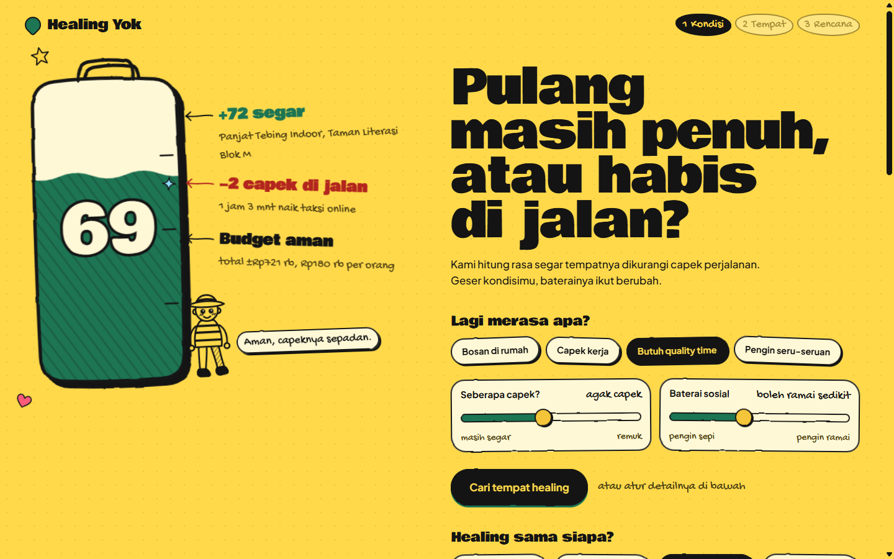

> **Ringkasan (Bahasa Indonesia).** Healing Yok adalah mockup web app untuk orang yang bingung mau healing ke mana. Isi kondisimu, lalu aplikasi memilihkan tempat, menyusun jadwal per jam, membandingkan 5 moda transportasi, dan memberi saran jujur. Skor **Healing Bersih** digambar sebagai baterai: rasa segar dari tempatnya dikurangi capek di jalan dan kelebihan budget. Kalau perjalanan menghapus efek healing, aplikasi berkata jujur dan menyarankan tempat yang lebih dekat. Semua data (tempat, harga, event, jarak) adalah **data dummy**.

---

## Contents

- [The problem](#the-problem)
- [The idea: Healing Bersih](#the-idea-healing-bersih)
- [How it works](#how-it-works)
- [Features](#features)
- [Scoring model](#scoring-model)
- [Design](#design)
- [Tech stack](#tech-stack)
- [Project structure](#project-structure)
- [Getting started](#getting-started)
- [Testing](#testing)
- [Deployment](#deployment)
- [Accessibility and performance](#accessibility-and-performance)
- [Before and after](#before-and-after)
- [Limitations and roadmap](#limitations-and-roadmap)
- [Credits](#credits)

---

## The problem

"Mau healing ke mana?" is a weekly question for people who are bored at home, tired from work, want quality time with family and kids, or just want to hang out with friends. The usual answer is to scroll social media for the most beautiful place, and that ignores what actually decides whether the outing recharges you: **the trip itself**. Two hours of traffic with tired kids can cancel out a beautiful park. A trip planner optimizes the destination; Healing Yok optimizes how you feel when you get home.

## The idea: Healing Bersih

Every plan gets one number from 0 to 99, shown as the charge of a hand-drawn battery:

```
Healing Bersih = refreshment from the places
               - stress and fatigue on the road
               - budget overrun
               - penalty when most of the day is spent travelling
```

The battery explains itself with handwritten notes (for example `+72 segar`, `-2 capek di jalan`, `Budget aman`), so the number is never a black box. When the score drops, the crew character at its foot says so ("Merah nih. Coba tempat yang lebih dekat.") and the advice section suggests a closer place. Honesty over hype is a product principle: the app shows the real cost of travel even when it makes the plan look worse.

| Charge | Verdict | Battery colour | Crew at the battery |
| --- | --- | --- | --- |
| 80 and up | Healing maksimal | Green | Yeti |
| 75 to 79 | Healing aman | Green | Yeti |
| 65 to 74 | Healing aman | Green | Kid |
| 50 to 64 | Lumayan, tapi ada catatan | Amber | Cat |
| under 50 | Capek di jalan | Red | Ghost |

## How it works

### Step 1: Kondisi (your condition)

Pick a mood, who you go with, how long, when you start, where you leave from and your budget, then set how tired you are and your social battery. **The battery recalculates live on every change**: the liquid rises with bubbles when the plan gets better and drips red when it gets worse, and the notes re-tick their numbers.

| Charged | Drained |
| --- | --- |
|  | 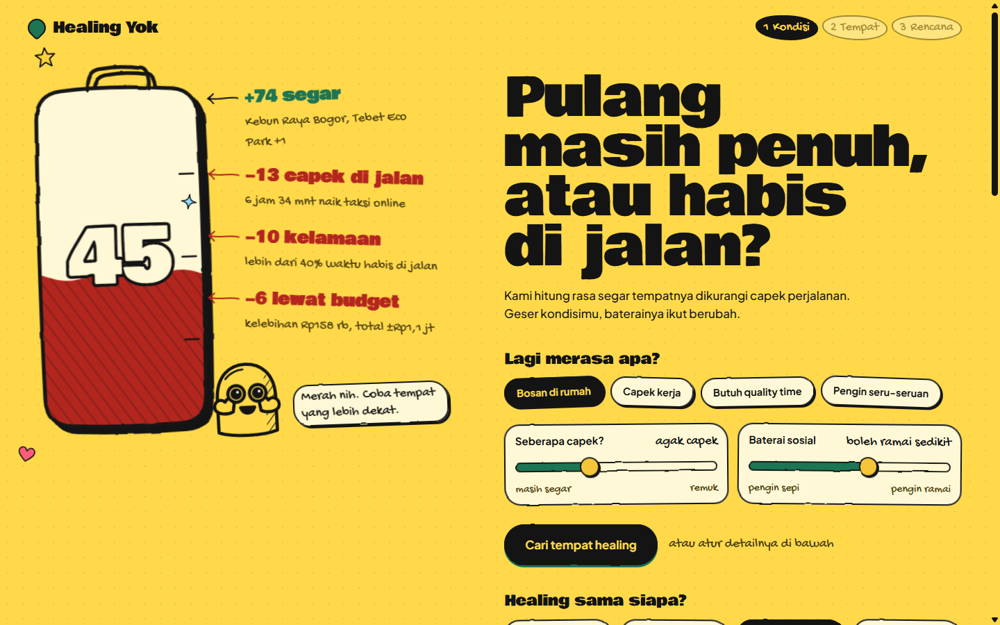 |
| Family, half day in the afternoon, nearby places: **69**. | Family, full day from the morning, Kebun Raya Bogor picked: **45**, with 6+ hours on the road. |

The departure zone can also be picked by tapping a tile on the 3D Jabodetabek map.

### Step 2: Tempat (places)

Places are ranked by fit for your condition and pre-picked for you (a stay for staycations plus places from different categories). Each card shows a "segar" bar, price, crowd level, indoor or outdoor, and whether it suits kids. The battery on the side shows the plan you would get with your current picks, so every pick visibly charges or drains it.

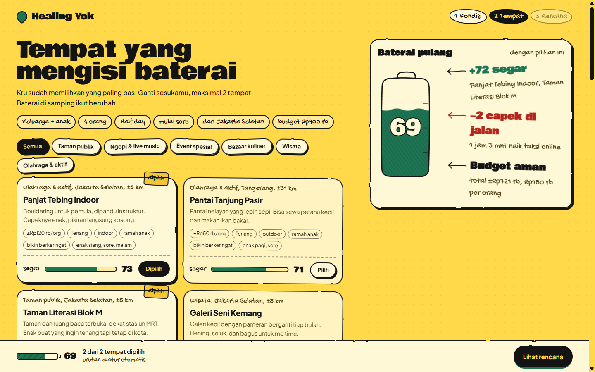

### Step 3: Rencana (the plan)

The **Kartu Healing** ticket leads with the verdict and the battery, plus the notes that explain it. Below it:

- **Plan B hujan**: one toggle swaps outdoor places for the best indoor alternatives and marks them in the schedule.
- **Transport comparison** for 5 modes (public transport, motorbike, private car, ride-hailing taxi, and a public transport plus last-mile ride mix). Each mode shows the battery you would come home with, its cost and its time on the road, with "paling seimbang" and "paling hemat" badges.
- **Saran jujur**: honest advice as sticky notes, for example over budget, too long on the road, a motorbike with kids, or a nearer alternative.
- **Hourly schedule**, multi-day for staycations, and a **3D route map**.
- **Video rekap**: a 9:16 recap for Story or WhatsApp status, rendered from the plan data.
- **Salin rencana / Salin link**: copy the plan as text for the group chat, or copy a link that reopens exactly the same plan.

| Kartu Healing | Modes, advice and schedule |
| --- | --- |
| 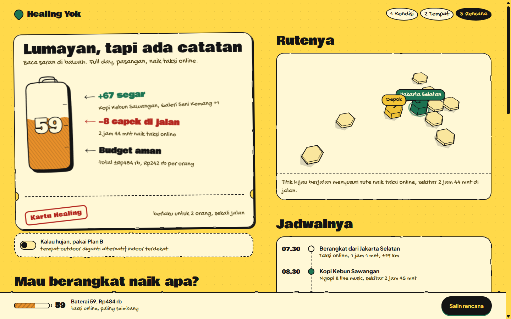 | 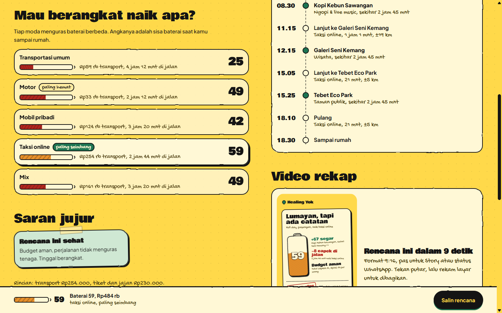 |

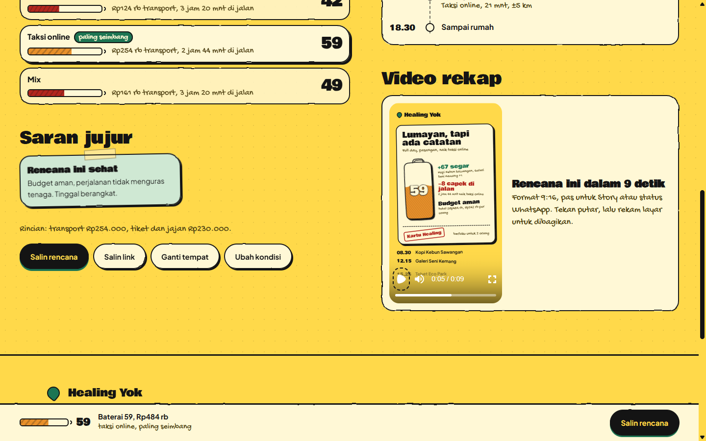

The page closes with the doodle crew footer: the HEALING YOK wordmark with characters that look at your cursor, hop when clicked, and say their line.

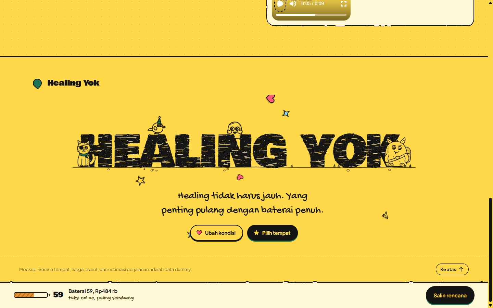

## Features

- **Live "Baterai pulang"**: the battery and its plus and minus notes update while you drag a slider.
- **Explainable score**: the score is split into `segar`, `jalan`, `budget` and `lama`, and every displayed note comes from those parts.
- **Auto-pick**: good defaults are chosen for you, with a stay for staycations and varied categories.
- **Plan B for rain**: outdoor stops are replaced by indoor alternatives.
- **5 transport modes** with dummy tariffs, parking and tolls, compared on cost, time and stress.
- **Honest advice** generated by rules, not by an LLM, so the same plan always gets the same advice.
- **Share link**: the whole plan lives in `location.hash` and every value is validated when the link is opened.
- **Copy plan**: plain text for WhatsApp, including the share link.
- **3D zone map**: three.js in an ink and toon style, showing the departure zone, picked zones and an animated route.
- **Recap video**: a Remotion composition at 1080x1920, deterministic per frame.
- **Reacting crew**: the character changes with the charge band.
- **Light and night themes** that follow the device setting.
- **Responsive**: two columns on desktop, a sticky battery strip on phones, with no horizontal scroll at 390px.
- **Motion that respects `prefers-reduced-motion`**: smooth scroll, waves, doodles and the 3D loop all switch off.

## Scoring model

The model is deterministic and lives in [`src/domain/engine.ts`](src/domain/engine.ts). The full specification is in `HANDOFF.md` section 6.

**Place fit, `fit(p)`, 0 to 99**

```
f = heal
  - |crowd - socialBattery| x 30
  - 25                         family with kids and the place is not kid friendly
  - km x 0.2 x (0.5 + tiredness)
  - 18                         half day and distance over 35 km
  - 9 (half) / 4 (full)        start time does not suit the place
  - max(0, tiredness - 0.45) x 40   active or sport place
  + 6                          sport place and mood "seru"
  - 15                         cost per person over 60% of budget per person
  - 18                         raining and outdoor
```

**Healing Bersih, `plan(mode).score`**

```
score = average fit (the stay counts twice)
      - stress(mode) x hoursOnRoad x 13 x (0.6 + tiredness)    -> "capek di jalan"
      - (overBudget / budget) x 35                              -> "lewat budget"
      - 10 if day trip and road time > 40% of available hours  -> "kelamaan"
clamp 0..99
```

**Dummy tariffs per leg** (`n` = number of people)

| Mode | Cost | Time |
| --- | --- | --- |
| Public transport | `n x (4,000 + min(km x 280, 16,000))` | `km/16 x 60 + 18` min, x1.3 over 45 km |
| Motorbike | `ceil(n/2) x km x 380` + parking 5,000 per bike per stop | `km/26 x 60 + 5` |
| Private car | `ceil(n/7) x (km x 1,300 + toll 13,000 over 14 km)` + parking 12,000 per stop | `km/18 x 60 + 10` |
| Ride-hailing taxi | `ceil(n/4) x (12,000 + km x 4,300)` | `km/21 x 60 + 7` |
| Mix | public transport + last-mile ride | `km/19 x 60 + 12` |

Staycation: `ceil(n / capacity) x price x nights`, plus meals at `n x 90,000 x nights`.

## Design

The visual world is a **sketchbook drawn by a doodle crew**, and the structure is called **"Baterai pulang"** (the battery you come home with). It was chosen from three concept sketches during the design round.

- **Palette**: sunny yellow page (`#ffd94a`), paper cards (`#fff8d6`), ink (`#141414`). Leaf green means charge, red means drain, amber is in between. The night theme uses warm ink with cream lines.
- **Type**: [Bowlby One](https://fonts.google.com/specimen/Bowlby+One) for headlines and numbers, [Gochi Hand](https://fonts.google.com/specimen/Gochi+Hand) for handwritten notes, and [Plus Jakarta Sans](https://fonts.google.com/specimen/Plus+Jakarta+Sans) for UI text. All are self-hosted through Fontsource.
- **Hand-drawn lines**: every card, sticker, slider and rule draws its ink outline through one shared SVG displacement filter (`#sk-rough`), so the whole app wobbles slightly like ink on paper, not only the battery.
- **Motion**: one ease curve, `cubic-bezier(0.22, 1, 0.36, 1)`. Outlines draw in on first view, the battery liquid eases to its new level, and steps change with View Transitions.

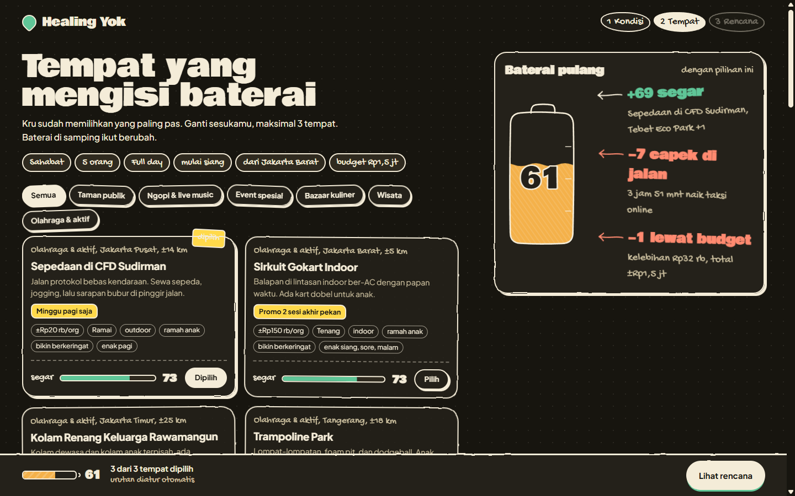

| Mobile, step 1 | Mobile, step 3 |
| --- | --- |
| 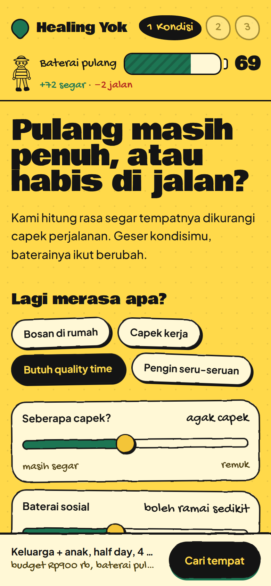 | 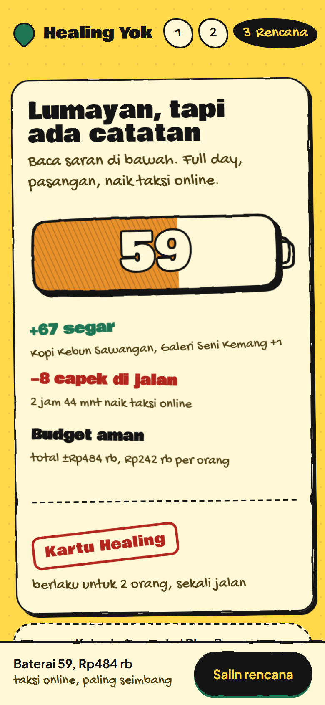 |

The full design system is documented in [`DESIGN.md`](DESIGN.md), and product truth is in [`PRODUCT.md`](PRODUCT.md).

## Tech stack

| Layer | Tools |
| --- | --- |
| App | [React 19](https://react.dev), TypeScript, [Vite 8](https://vite.dev) |
| Styling | [Tailwind CSS v4](https://tailwindcss.com) with CSS-variable tokens, shadcn-style structure (`components.json`, `@/` alias, `src/components/ui`) |
| 3D | [three.js](https://threejs.org) (vanilla, lazy-loaded) |
| Video | [Remotion](https://www.remotion.dev) Player (lazy-loaded) |
| Motion | [Lenis](https://lenis.darkroom.engineering) smooth scroll, CSS keyframes, View Transitions API |
| Fonts | [Fontsource](https://fontsource.org) (self-hosted) |
| Tests | [Vitest](https://vitest.dev) |
| Hosting | [Cloudflare Pages](https://pages.cloudflare.com), auto-deploy from `main` |

There is no backend and no database. All data is dummy, and the whole app runs in the browser.

## Project structure

```
healing-yok/
├── index.html                  # Vite entry
├── src/
│   ├── App.tsx                 # header, steps, dock, share-link sync, view transitions
│   ├── index.css               # theme tokens (light + night), sketch outlines, motion
│   ├── domain/                 # pure logic, no DOM
│   │   ├── data.ts             # zones, places, durations, groups, moods, modes, State
│   │   ├── engine.ts           # fit, autoPick, stops, plan, advice, projection, routeZones
│   │   ├── store.ts            # state transitions (goStep, togglePick, ...)
│   │   ├── share.ts            # State <-> location.hash, validated
│   │   ├── format.ts           # rupiah, minutes, clock
│   │   └── domain.test.ts      # checklist and scoring tests
│   ├── components/
│   │   ├── StepKondisi.tsx     # step 1, the battery hero
│   │   ├── StepTempat.tsx      # step 2, places plus battery panel
│   │   ├── StepRencana.tsx     # step 3, ticket, modes, advice, schedule, map, video
│   │   ├── controls.tsx        # stickers, tiles, toggle, button, slider
│   │   ├── sketch/             # Battery, BatteryWide, BatteryStrip, ChargeNotes, Doodles
│   │   ├── MapCard.tsx, ZoneMap3D.tsx
│   │   ├── SiteFooter.tsx
│   │   └── ui/doodle-crew-footer-sunny.tsx
│   ├── video/                  # RecapVideo (Remotion composition), RecapPlayer
│   └── lib/                    # cn(), Lenis smooth scroll, clipboard
├── docs/screenshots/           # images used in this README
├── legacy/index.html           # the original single-file vanilla mockup
├── DESIGN.md                   # design system
└── PRODUCT.md                  # product truth
```

## Getting started

Requirements: Node.js 22 or newer.

```bash
git clone https://github.com/gonkricaw/healing-yok.git
cd healing-yok
npm install
npm run dev        # http://localhost:5173
```

| Command | What it does |
| --- | --- |
| `npm run dev` | Start the Vite dev server |
| `npm test` | Run the domain tests (Vitest) |
| `npm run typecheck` | Run the TypeScript check |
| `npm run build` | Typecheck and build for production into `dist/` |
| `npm run preview` | Serve the production build locally |

Try a shared plan directly, for example
[a family staycation that drains the battery](https://healing-yok.pages.dev/#s=3&mood=bosan&g=keluarga&n=4&d=stay2&w=pagi&h=jaksel&b=900000&t=0&c=35&so=60&r=0).

## Testing

`npm test` runs 14 tests in `src/domain/domain.test.ts`:

- Every combination of duration × start time × group × rain × departure zone (**1,152 cases**) reaches step 3 with finite scores and at least one piece of advice.
- "Mode tanggal tua" locks the budget at Rp50 rb per person and follows the number of people.
- A staycation without a stay shows the "Pilih satu penginapan dulu" toast.
- Plan B replaces every outdoor stop and marks it in the schedule.
- The demo scenario (family of 4, staycation 2 nights, Rp900 rb) drops the score and shows "Lewat budget" and "Jujur saja".
- The score parts always add up to the displayed score.
- The default state opens charged (65 or more) with a short trip.
- With the same places, more tiredness never raises the battery.
- Regression: jumping from step 1 to step 3 after changing the duration re-picks places, so no stale stay is carried over.
- The share link round-trips a full plan, and malformed or hostile hash values fall back to safe defaults.

## Deployment

The site is hosted on **Cloudflare Pages** and connected to this GitHub repository. Every push to `main` deploys to production, and other branches get a preview URL.

| Setting | Value |
| --- | --- |
| Framework preset | None |
| Build command | `npm run build` |
| Build output directory | `dist` |
| Environment variable | `NODE_VERSION=22` |
| Production branch | `main` |

## Accessibility and performance

- Every control is keyboard reachable with a visible dashed focus ring. Batteries are `role="meter"` with live values, and slider values have `aria-valuetext`.
- `prefers-reduced-motion` turns off smooth scroll, battery waves, bubbles, floating doodles and the 3D animation loop.
- The 3D loop only runs while the map is on screen and the tab is visible. Device pixel ratio is capped at 1.75.
- The initial bundle is about 118 kB gzip (JS) plus 11 kB (CSS). three.js (about 140 kB gzip) and Remotion (about 111 kB gzip) are code-split and only load when needed.

## Before and after

The project started as a single static HTML file with vanilla JavaScript. It was rebuilt as a React app around the battery concept.

| Before | After |
| --- | --- |
| 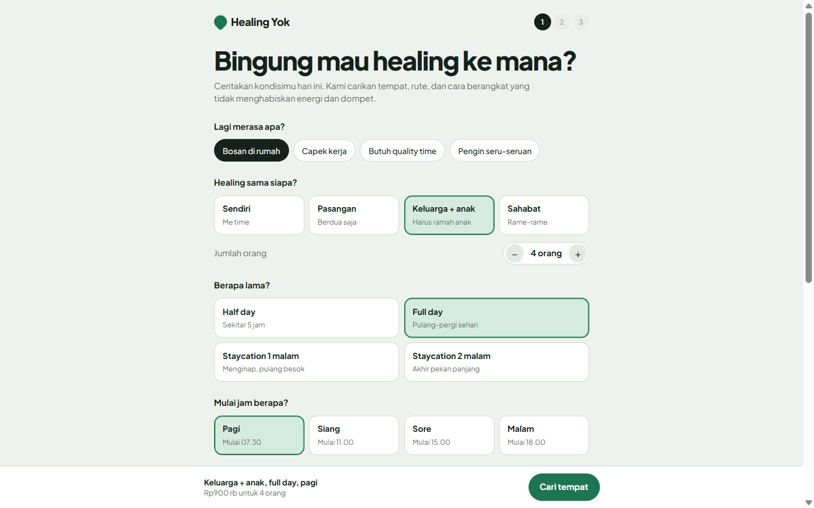 |  |

## Limitations and roadmap

This is a **mockup**. Places, prices, events and distances are fictional (see `src/domain/data.ts`), and there are no accounts and no backend.

- [ ] Real place data, opening hours, and events tied to the day of the week
- [ ] Download the recap as MP4 (needs a Remotion render step on a server)
- [ ] Custom domain
- [ ] Optional free-text condition input ("capek banget, bawa 2 anak, budget 500 rb"), which needs a small backend for an LLM
- [ ] Open Graph image and favicon for nicer link previews

## Credits

- Built with [Claude Code](https://claude.com/claude-code) as the Final Project of **Claude for Non-Tech Professionals, MBCL Cohort 3**.
- The doodle crew footer is a community React component, integrated as-is with added label and logo props (`src/components/ui/doodle-crew-footer-sunny.tsx`).
- Fonts are under the SIL Open Font License.
- The Remotion Player is free for individuals and companies of up to 3 people. Larger teams need a [Remotion company license](https://www.remotion.dev/license).
